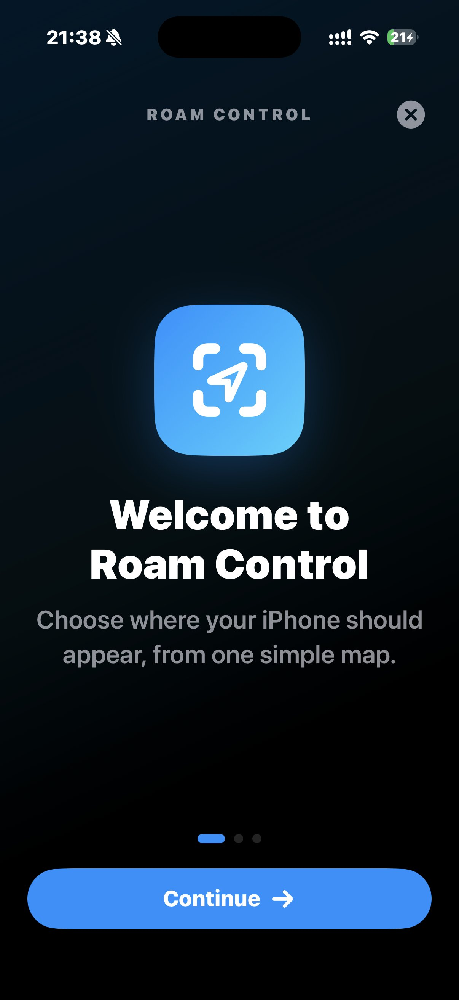
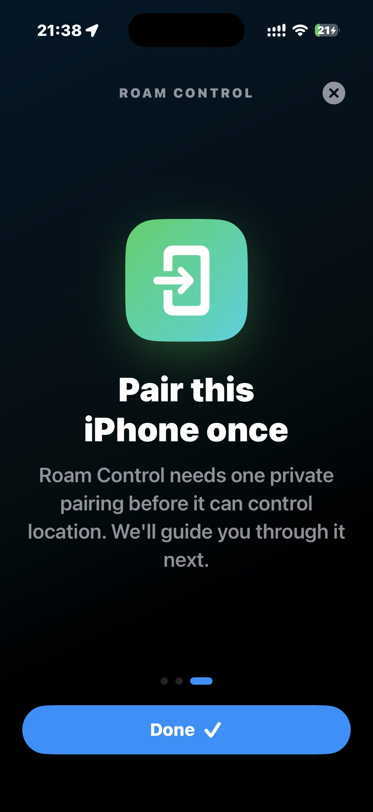
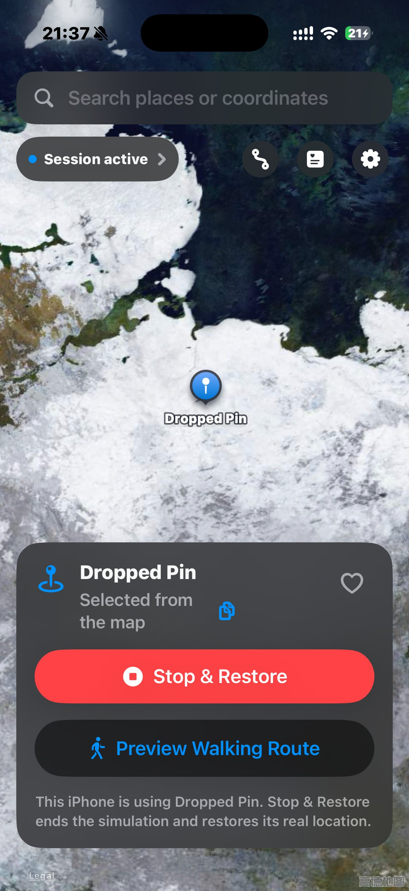
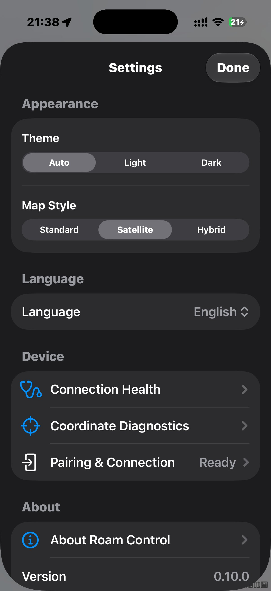

  

<h1 align="center">Roam Control — routes fork</h1>

  Move an iPhone's reported location, then run it along a route you drew yourself.

  <strong>Current release:</strong> 0.10.0 (62) · <a href="https://github.com/FaHits/Roam-Control/releases/tag/v0.10.0">Download unsigned IPA</a> · <strong>Requires:</strong> iOS 27+

  
  
  
  

Roam Control is a source-available SwiftUI app for location-based development, quality assurance and responsible personal testing on an iPhone you own and control. It pairs with your own device over LocalDevVPN and moves the reported location — either to a fixed point, or along a route.

**This repository is the `FaHits` fork of [hxhlb/Roam-Control](https://github.com/hxhlb/Roam-Control).** On top of the upstream fixed-location and Apple Maps walking features, it adds a complete drawn-route system: a loop editor, a persistent route library, out-and-back runs, and a humanised running engine that keeps route progress independent of GPS noise.

## The route system

- **Draw a closed loop by tapping.** Tap points on the map to build a route; the ends are joined into one seamless loop, and the editor previews the geometry that will actually be run.
- **A route library that survives relaunch.** Routes are stored in `Application Support/RoamControl/routes.json`, each with its own run configuration, and can be renamed and deleted. Deletion asks first and leaves the list untouched until you confirm.
- **Out-and-back runs on open routes.** Choose how many one-way trips to run: an odd count finishes at the far end, an even count brings you back to the start. The run card shows `2/3`-style trip progress instead of laps.
- **Laps or continuous mode for loops.** Run a fixed number of laps, or keep going until you stop.
- **Humanised running.** Speed wobble, cadence and smoothed GPS jitter make the reported track look like a person moving. Jitter only touches the reported coordinate — it never moves the saved route progress, so the run stays exactly on its geometry.
- **Run card and recovery.** Live distance, lap/trip progress, elapsed time, pause and resume; an interrupted run comes back as a recovery card that names the route and where you stopped.
- **One map style everywhere.** Standard, satellite and hybrid are mapped once and shared by the main map and the route editor, which can switch style in place.
- **Chinese and English.** The whole interface is localised (615 keys, zh-Hans complete). The restart prompt compares the language you will see next launch against the one on screen right now, so two names for the same language never nag you.
- **Coordinates converted once, at the injection boundary.** MapKit returns GCJ-02 inside mainland China while the device session expects WGS-84; the conversion happens at the single place a coordinate is injected, never as a hard-coded offset.
- **No analytics.** The usage-statistics feature and its `PrivacyInfo.xcprivacy` entries are gone; nothing is reported anywhere.

The suite runs 158 unit tests covering route geometry, persistence, the runner, recovery, map styles and language selection.

## Screenshots

  
  
  
  

  Welcome · Pair once · Session active · Settings

## Also included from upstream

- Search places live with MapKit, enter coordinates or tap the map.
- Start a fixed reported location and update it without reconnecting.
- Preview an Apple Maps walking route before starting; pause, resume, reverse or redirect an active walk.
- Save named favourites and revisit recent locations.
- Restore the real location explicitly when testing is finished.
- Recover safely after an interrupted fixed or walking session.
- Follow separate, guided LocalDevVPN flows for Wi-Fi and mobile data.
- Choose automatic, light or dark appearance, and use Dynamic Type, VoiceOver and Reduce Motion.

## Builds

Roam Control is not distributed through the App Store or TestFlight. Release **0.10.0 (62)** is published on the [Releases page](https://github.com/FaHits/Roam-Control/releases/tag/v0.10.0) as an unsigned release IPA (`RoamControl-unsigned.ipa`); it must be signed with your own Apple account before it can be installed. A debug build is available from the CI run's `unsigned-ipa-debug` artifact when one is needed for troubleshooting.

You will need:

- An iPhone running iOS 27 or newer.
- Developer Mode enabled.
- [LocalDevVPN](https://apps.apple.com/app/localdevvpn/id6755608044).
- SideStore, or Xcode on a Mac.

Read the complete [installation guide](Documentation/Installation.md) before installing. Free Apple accounts remain subject to Apple's app-count and seven-day refresh limits.

## First-time setup

1. Install and open Roam Control.
2. Complete the three-page introduction.
3. Tap **Pair This iPhone** on Device Setup.
4. Open **Settings → Privacy & Security → Developer Mode → Pair with Roam Control**.
5. Enter the six-digit code shown in Roam Control.
6. Install and connect LocalDevVPN.
7. Choose a fixed location, or open Routes and draw a route to run.

The pairing record is stored in the iPhone Keychain and is never uploaded.

## Privacy

Locations, coordinates, searches, favourites, history, drawn routes, run progress and pairing records stay on the iPhone; routes and runs live in the app's own Application Support directory.

This build collects no usage statistics and embeds no third-party analytics SDK. The only network traffic is the local developer tunnel to your own device, plus a GitHub release lookup when you ask the app to check for updates.

Read [Privacy](Documentation/Privacy.md) for the on-device data disclosure.

## Responsible use

Roam Control is intended for development and testing on a device you own and control. Location simulation can affect every app using the iPhone's reported position. Restore the real location before using navigation, emergency, safety, transport or location-sharing features.

Do not use Roam Control to mislead another person, falsify evidence, access something you are not entitled to use, evade safeguards or breach a third-party service's rules. See [Responsible Use](Documentation/ResponsibleUse.md).

## Build from source

1. Clone the repository and open `RoamControl.xcodeproj` in Xcode 27 or newer.
2. Select the Roam Control target.
3. Choose your own Apple development team under **Signing & Capabilities**.
4. Select a connected iPhone and press **Run**.

The iPhone simulator is useful for interface work but cannot complete the physical pairing handshake or start a location session.

Normal builds use the included `Frameworks/RoamPairingFFI.xcframework`, which carries arm64 iPhone and Apple Silicon simulator slices. Rebuild it only after changing `Native/RoamPairingFFI`; instructions are in the [build and release guide](Documentation/BuildAndRelease.md).

Run the tests with `⌘U`, or let CI do it: `.github/workflows/xcode-27.yml` runs the suite and builds both an unsigned release and debug IPA on every push to `main` and to the development branch.

## How it works

Roam Control generates or imports an RPPairing record for the same iPhone and stores it in the device-only Keychain. When a location starts, it discovers that iPhone's remote-pairing service through LocalDevVPN, verifies the device identity and opens the encrypted developer session used to set or clear a simulated location.

A drawn route is app-side geometry: the runner advances along the polyline on a timer, and an injector reports the interpolated coordinate through that same device session. Because progress and reported position are separate concerns, GPS jitter can be cosmetic without derailing the run.

The native engine is a narrow Rust-to-Swift bridge around the MIT-licensed [`idevice`](https://github.com/jkcoxson/idevice) library, pinned to an exact revision.

## Versioning and releases

App version, build number and the route file format's `schemaVersion` are managed separately; the rules are in [VERSIONING.md](VERSIONING.md). `v0.10.0` is the first release of the route system. Release notes live in [CHANGELOG.md](CHANGELOG.md), and the per-task engineering ledger in [ImplementationStatus.md](Documentation/ImplementationStatus.md).

## Documentation

- [Installation](Documentation/Installation.md)
- [User guide](Documentation/UserGuide.md)
- [Privacy](Documentation/Privacy.md)
- [Responsible use](Documentation/ResponsibleUse.md)
- [Build and release guide](Documentation/BuildAndRelease.md)
- [Regression checklist](Documentation/RegressionChecklist.md)
- [Versioning](VERSIONING.md)
- [Changelog](CHANGELOG.md)
- [Security policy](SECURITY.md)
- [Third-party notices](Documentation/Licensing/THIRD_PARTY_NOTICES.md)

## Community

Bugs and feature ideas about the route system belong in this repository's [Issues](https://github.com/FaHits/Roam-Control/issues). Security-sensitive reports go through GitHub Security Advisories.

Discussion of the upstream app happens in the upstream project's [Discord](https://discord.gg/fJrNvQ2Vdh); anything reported there is about `hxhlb/Roam-Control`, not this fork.

## Contributing

Bug reports and focused improvements are welcome. Read [CONTRIBUTING.md](CONTRIBUTING.md) before opening an issue or pull request, and never upload pairing records, signing material, credentials or private location information. Keep the coordinate conversion at the single injection boundary — no hard-coded offsets anywhere else.

## Licence

Roam Control's current source is available under the [PolyForm Noncommercial License 1.0.0](LICENSE). It may be used, modified and redistributed for non-commercial purposes under those terms. Commercial use requires separate permission from the project owner.

Roam Control 0.9.0 Beta 1 was released under the MIT Licence and remains available under those terms. The licence change applies to development after Beta 1 and does not revoke rights already granted for that release.

See [Licensing](Documentation/Licensing/LICENSING.md) for details. Bundled dependencies retain their own licences; see [Third-party notices](Documentation/Licensing/THIRD_PARTY_NOTICES.md).

## Upstream

This fork tracks [hxhlb/Roam-Control](https://github.com/hxhlb/Roam-Control), which provides the fixed-location engine, on-device pairing, LocalDevVPN flows and the Apple Maps walking simulation. The route system described above is specific to this fork and is not part of the upstream project.
